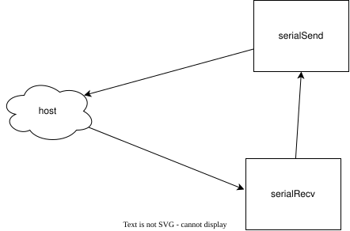

# FPGA Reverb

Real-time audio effects using an FPGA

`*-postfix` is the current version. There are branches for each version.

Go to [test](#practical)

## Glossary

- Host
```
The pc with connections to a microphone and a speaker. Sends data through UART.
```
- Device
```
The FPGA receiving the raw audio. It processes the audio and sends it back to the host through UART.
```

# 0.3.2 - Using FIFO to delay input

This is building on top of Third iteration.

## Microarchitecture Design

Delay FIFO. e.g. 10 clock cycles to see in simulation.

Delay FIFO multiple ms

### Modules

- UART Send module (serialSend)
- UART Receive module (serialRecv)
- Memory module (memoryManager)
  - Receives data from serialRecv
  - Saves it in BRAM FIFO
  - Sends it to serialSend after configurable amount of clock cycles

# 0.3.1 - Creating FIFO in BRAM

This is building on top of Third iteration.

Create a FIFO using BRAM.


# 0.3.0 - creating BRAM

This is the Third iteration of the design.

Save a value in BRAM.
Vivado should say that BRAM is created

# 0.2.1 - Look at existing IP blocks


# 0.2.0 - controlling volume

This is the second iteration of the design.

___

## Plan

Host sends audio through UART.

Device also have switches as input.
Device sends audio back scaled by switches through UART.

### FSMD

## Dev notes


# 0.1.4 - Increasing BAUD rate of port

Baud rate can be changed for a port.

1. Open device manger
2. Go to ports (COM & LPT)
3. Right click USB Serial Port
4. Properties
5. Port settings
6. Bits per second
7. Set to 921600

```
python .\scripts\serial_send.py COM4 -b 921600 --recv play
```

# 0.1.3* - ~~Registering FPGA as a usb device ~~ CANCELLED

https://github.com/WangXuan95/FPGA-USB-Device

It has been added as a submodule.

The [USB Audio top](FPGA-USB-Device/RTL/usb_class/usb_audio_top.v) will be used.

It requires 60MHz clock :/

Clocking guide: https://docs.amd.com/v/u/en-US/ug472_7Series_Clocking

> The USB audio device implements speaker + microphone. The file hierarchy is as follows. Please add these files to the FPGA project, compile and program it to the FPGA.
> - RTL/fpga_examples/**fpga_top_usb_audio.v**
>   - RTL/usb_class/**usb_audio_top.v**
>     - RTL/usbfs_core/**usbfs_core_top.v**
>       - Other .v files in RTL/usbfs_core/

# 0.1.2 - Use file instead of microphone

Send an audio file through uart and build the file from response.

Start receive = 8'11111111 8'00000000
Stop receive = 8'11111111 8'00000000

Start and stop are the same, and `FF 00` is common inside 16-bit audio, so the host escapes every
`FF` byte in the file as `FF FF`. Inside a frame `FF FF` is one data byte `FF` and `FF 00` is stop.
The echo design returns the bytes unchanged, so the escaping survives the round trip.

```
FF 00 | file bytes, each FF sent as FF FF | FF 00
```

```sh
python scripts/serial_file.py COM3 audio.wav               # send file, save what comes back
python scripts/serial_file.py COM3 --recv-only             # only wait for a file
python scripts/serial_file.py --no-serial audio.wav        # loopback test, no board
```

Received files are saved in `scripts/received_file/`.


# 0.1.1 - Increasing Baud rate

Same as 0.1.0 but with a baud rate of 320_000.

USB baud rate is not easily changeable.

# 0.1.0 - Sending and receiving audio

This is the first iteration of the design.

Here we just want host sending input through UART.
Device sending it back unaltered through UART.

## Hardware Specification (Device)
### Inputs

The host sends microphone data through UART
- PCM samples as UART bytes
  - 8 bits + 2 (start,stop)

### Outputs

The host receives data through UART
- Unaltered PCM input
  - Same format as input

### Clock and reset behavior

- One clock cycle delay?
  - Save in register, might be needed
  - The baud rate vs global clock muddies what this delay means
- Reset resets the UART handshake

### Data widths and numeric formats

- pcm data will be uint8

### Latency and throughput

- Should not notice a delay when audio is playing back

### Memory requirements

- BRAM is not used in this iteration. One layer buffer might be all that is needed
- Possibly big enough to have one sample block

### Error and corner-case behavior

- Dropping samples
- Clipping
- Distorted playback

### Target

- Basys3 FPGA board

## Microarchitecture Design

### Modules

- UART Send module (serialSend)
- UART Receive module (serialRecv)

For 0.1.0 we connect them directly
```
serialSend.bits := serialRecv.bits
```

### Protocols

Interfaces using ready/valid, buses, or custom protocols

- UART Protocol
  - serialSend
  - serialRecv

### Memory Placement and Type

- UART uses registers to match clock speed with baud rate

### FSMD



### Area Estimation

- Tx
  - 10 bits for Tx shift reg
  - counter reg is 20 bits
  - bits reg is 4 bits
  - 2x equality (20.w+4.w)
  - 1x not (4)
  - 1x and (1w&1w)
  - 1 x right shift (10.w)
  - 1 x adder (4.w)
- Rx
  - Similar to Tx

#### Rough estimate
- eq = ceil(60 / 6) +  ceil(12 / 6) = 12
- not = 1
- and = 1
- right shift = ceil(30 / 6) = 5
- adder = 2
- 12+1+1+5+2 = 21 6LUT

- total: ~50 6LUT (RX has more than Tx)
- 80 x dff (RX has more than Tx)

### Latency Estimation

Assuming one baud cycle.

## Chisel File Structure

```
fpga-reverb/
├── build.sbt
├── project/
│   ├── build.properties
├── scripts/
│   ├── requirements.txt
│   ├── serial_file.py
│   ├── serial_recv.py
│   └── serial_send.py
├── src/
│   ├── main/
│   │   └── scala/
│   │       └── serial/
│   │           ├── serialSend.scala
│   │           └── serialRecv.scala
│   └── test/
│       └── scala/
│           └── serial/
│               ├── serialSendSpec.scala
│               └── serialRecvSpec.scala
├── Basys3_Master.xdc
└── README.md
```

### build.properties

```
sbt.version = 1.13.0
```

## Implement in Chisel

Development notes are added here

Audio is very distorted. Baud rate is the bottle neck


## Tests

### serialRecvSpec

- UART host sender needs to be mocked (senderMock)
- Are the values from senderMock set in 

### serialSendSpec


## Synthesize to Hardware

Vivado will be used.


___

# Practical

## Development setup (VS Code + Metals)

### One-time setup per computer

1. Install **JDK 21** ([Temurin](https://adoptium.net/)). Set `JAVA_HOME` to it and put `%JAVA_HOME%\bin` first on `PATH`.
   Remove old Javas (e.g. Oracle Java 8) so `java -version` prints 21.
2. Install **sbt** in a path **without spaces**, e.g. `scoop install sbt` or `cs setup`.
   The Windows installer puts it in `C:\Program Files (x86)\sbt`, and the space in that path breaks Metals' connection to sbt.
   `where sbt` (`Get-Command` for ps1) should print only one location.
3. Install VS Code and the **Scala (Metals)** extension. In user settings, set `"metals.javaHome"` to the JDK 21 folder.

### First time opening the repo

1. `git clone` and open the folder in VS Code.
2. Click **Import build** when Metals asks. If it asks which build server to use, choose **Bloop**
   (to change it later: `Metals: Switch build server`).
3. Wait for the import to finish in the status bar. `Metals: Run doctor` should list `fpga-reverb` with Scala 2.13.18.

If red bar saying `No Target`: Press on it.

`.bsp/`, `.bloop/`, `.metals/`, `.vscode/` and `project/metals.sbt` are machine-specific and git-ignored.
`project/build.properties` is committed, so every computer uses the same sbt version.

### Every day

- Open the folder and wait for Metals to finish loading. That's all you need to do.
- After changing `build.sbt`, or pulling a change to it: accept the **Import build** prompt (or run `Metals: Import build`).
- If Metals misbehaves, try these in order:
  1. `Metals: Restart build server`
  2. `Metals: Import build`
  3. Close VS Code, delete `.bloop`, `.bsp`, `.metals`, `target` and `project/target`, reopen, then **Import build**.


## Running Tests

```sh
sbt test
```
You should see a whole bunch of output that ends with something like the following lines
```
[info] Tests: succeeded 1, failed 0, canceled 0, ignored 0, pending 0
[info] All tests passed.
[success] Total time: 5 s, completed Dec 16, 2020 12:18:44 PM
```


## Convert to SystemVerilog

```sh
sbt run
```

### Debugging

Ensure `emitVerilog` in object


## Host Setup

### Installing dependencies

```sh
cd scripts/
```

The rest of the commands are assumed to be in `scripts/`

```sh
python -m venv .venv
```

#### Bash
```sh
source .venv/bin/activate
```

#### Powershell

```ps1
.\.venv\Scripts\activate.ps1
```

___

Should look like this after activating
```sh
(.venv) fpga-reverb/scripts>
```
The rest of the commands are assumed to be in the activated virtual environment.
___
To install the dependencies run

```sh
pip install -r ./requirements.txt
```

### Running script

Help found at
```sh
python ./serial_send.py --help
```

Simple usage
```
python ./serial_send.py MIC_PORT
```


A typical example for windows
```sh
python scripts/serial_send.py COM3
```


___

```

python scripts/serial_recv.py -h, python scripts/serial_send.py -h: the CLIs parse.
python scripts/serial_send.py --no-serial --recv play: you hear your mic with about 100 ms of delay (use headphones).
python scripts/serial_send.py --no-serial --recv hex: a hex dump scrolls.
With the Basys3 echo design: python scripts/serial_send.py COM3 -b <baud> --recv play plays the echoed audio, and --recv hex shows the echoed bytes. python scripts/serial_recv.py COM3 -m hex works on its own.


python scripts/serial_send.py COM4 -b <baud> --recv play   # send mic, play what comes back
python scripts/serial_send.py COM4 -b <baud> --recv hex    # send mic, print the returned bytes
python scripts/serial_recv.py COM4 -m hex                  # receive only
python scripts/serial_send.py --no-serial --recv play      # no board: loops your mic back to the speakers
```
