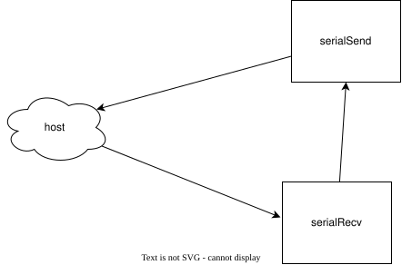
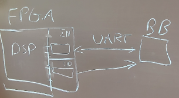

# Development log

Iteration notes from 0.1.0 onward. Raw material for the report (see [report/report.md](../report/report.md)).

## Glossary

- Host
```
The pc with connections to a microphone and a speaker. Sends data through UART.
```
- Device
```
The FPGA receiving the raw audio. It processes the audio and sends it back to the host through UART.
```

# 0.3.2 - Have audio playback delayed

The [test setup](#test-setup) can probably be adapted to do this.

Maybe [fifo_lines.svg](../report/docs/fifo_lines.svg) can be of inspiration.

Kind of have to rethink what it means with delay for a FIFO. Since we probably want an input and output buffer in the real setup as well. Or at least for the processed. But then yes fifo lines might be valid for processed data.


# 0.3.0 - Create Delay*


# 0.2.0 - Create report and follow goals again

Report has been started. It has given structure and an overview. Can be found at
[`report/report.md`](report/report.md)


# 0.1.4 - Increasing BAUD rate of port (Left open for later if there is time)

Baud rate can be changed for a port.

1. Open device manger
2. Go to ports (COM & LPT)
3. Right click USB Serial Port
4. Properties
5. Port settings
6. Bits per second
7. Set to 921600

```
python .\scripts\serial_send.py COM4 -b 921600 --recv play
```

> [!warning] Some machines do not allow a baud rate of 921600.
> The bit depth and sample rate can be lowered instead (`sampleWidth` and `sampleRate` in
> [`Env.scala`](src/main/scala/utils/Env.scala)), but the audio is then noticeably less clear.

## Debugging the UART

`scripts/uart_debug.py` checks the link itself rather than the audio going
over it. It defaults to the baud rate it reads back out of `EchoDemo.v`, so it
cannot silently test at the wrong rate.

```
python scripts/uart_debug.py --mode check          # framing maths, no board needed
python scripts/uart_debug.py COM4                  # echo test + diagnosis
python scripts/uart_debug.py COM4 --mode sweep     # which baud is the bitstream using?
python scripts/uart_debug.py COM4 --mode framing   # stop-bit / parity mismatch
python scripts/uart_debug.py COM4 --mode monitor --seconds 5 --send
python scripts/uart_debug.py COM4 --mode monitor --hold    # record while SPACE is held
python scripts/uart_debug.py --loop                # exercise the script, no board
```

At 100 MHz and 921600 baud the divider lands on 109 cycles per bit, so the
FPGA actually runs at 917,431 baud (-0.45%). That costs 4.3% of a bit cell by
the stop bit, against a 50% budget -- fine, but it is the first thing to check
when bytes start arriving corrupted in their high bits.

# 0.1.3* - ~~Registering FPGA as a usb device ~~ CANCELLED

https://github.com/WangXuan95/FPGA-USB-Device

It has been added as a submodule.

The [USB Audio top](FPGA-USB-Device/RTL/usb_class/usb_audio_top.v) will be used.

It requires 60MHz clock :/

Clocking guide: https://docs.amd.com/v/u/en-US/ug472_7Series_Clocking

> The USB audio device implements speaker + microphone. The file hierarchy is as follows. Please add these files to the FPGA project, compile and program it to the FPGA.
> - RTL/fpga_examples/**fpga_top_usb_audio.v**
>   - RTL/usb_class/**usb_audio_top.v**
>     - RTL/usbfs_core/**usbfs_core_top.v**
>       - Other .v files in RTL/usbfs_core/

# 0.1.2 - Use file instead of microphone

Send an audio file through uart and build the file from response.

Start receive = 8'11111111 8'00000000
Stop receive = 8'11111111 8'00000000

Start and stop are the same, and `FF 00` is common inside 16-bit audio, so the host escapes every
`FF` byte in the file as `FF FF`. Inside a frame `FF FF` is one data byte `FF` and `FF 00` is stop.
The echo design returns the bytes unchanged, so the escaping survives the round trip.

```
FF 00 | file bytes, each FF sent as FF FF | FF 00
```

```sh
python scripts/serial_file.py COM3 audio.wav               # send file, save what comes back
python scripts/serial_file.py COM3 --recv-only             # only wait for a file
python scripts/serial_file.py --no-serial audio.wav        # loopback test, no board
```

Received files are saved in `scripts/received_file/`.


# 0.1.1 - Increasing Baud rate

Same as 0.1.0 but with a baud rate of 320_000.

USB baud rate is not easily changeable.

# 0.1.0 - Sending and receiving audio

This is the first iteration of the design.

Here we just want host sending input through UART.
Device sending it back unaltered through UART.

## Hardware Specification (Device)
### Inputs

The host sends microphone data through UART
- PCM samples as UART bytes
  - 8 bits + 2 (start,stop)

### Outputs

The host receives data through UART
- Unaltered PCM input
  - Same format as input

### Clock and reset behavior

- One clock cycle delay?
  - Save in register, might be needed
  - The baud rate vs global clock muddies what this delay means
- Reset resets the UART handshake

### Data widths and numeric formats

- pcm data will be uint8

### Latency and throughput

- Should not notice a delay when audio is playing back

### Memory requirements

- BRAM is not used in this iteration. One layer buffer might be all that is needed
- Possibly big enough to have one sample block

### Error and corner-case behavior

- Dropping samples
- Clipping
- Distorted playback

### Target

- Basys3 FPGA board

## Microarchitecture Design

### Modules

- UART Send module (serialSend)
- UART Receive module (serialRecv)

For 0.1.0 we connect them directly
```
serialSend.bits := serialRecv.bits
```

### Protocols

Interfaces using ready/valid, buses, or custom protocols

- UART Protocol
  - serialSend
  - serialRecv

### Memory Placement and Type

- UART uses registers to match clock speed with baud rate

### FSMD



### Area Estimation

- Tx
  - 10 bits for Tx shift reg
  - counter reg is 20 bits
  - bits reg is 4 bits
  - 2x equality (20.w+4.w)
  - 1x not (4)
  - 1x and (1w&1w)
  - 1 x right shift (10.w)
  - 1 x adder (4.w)
- Rx
  - Similar to Tx

#### Rough estimate
- eq = ceil(60 / 6) +  ceil(12 / 6) = 12
- not = 1
- and = 1
- right shift = ceil(30 / 6) = 5
- adder = 2
- 12+1+1+5+2 = 21 6LUT

- total: ~50 6LUT (RX has more than Tx)
- 80 x dff (RX has more than Tx)

### Latency Estimation

Assuming one baud cycle.

## Chisel File Structure

```
fpga-reverb/
├── build.sbt
├── project/
│   ├── build.properties
├── scripts/
│   ├── requirements.txt
│   ├── serial_file.py
│   ├── serial_recv.py
│   ├── serial_send.py
│   └── uart_debug.py
├── src/
│   ├── main/
│   │   └── scala/
│   │       └── serial/
│   │           ├── serialSend.scala
│   │           └── serialRecv.scala
│   └── test/
│       └── scala/
│           └── serial/
│               ├── serialSendSpec.scala
│               └── serialRecvSpec.scala
├── Basys3_Master.xdc
└── README.md
```

### build.properties

```
sbt.version = 1.13.0
```

## Implement in Chisel

Development notes are added here

Audio is very distorted. Baud rate is the bottle neck


## Tests

### serialRecvSpec

- UART host sender needs to be mocked (senderMock)
- Are the values from senderMock set in 

### serialSendSpec


## Synthesize to Hardware

Vivado will be used.


# Backlog


## Test Setup

> [!note] Inspired by a note from Emad Jacob Maroun
> 
> 
> **BB is `bærbar` (laptop). UD is out.**

- Split the FPGA into
  - DSP
    - Here it would maybe just be a counter to simulate processing
  - Input buffer
    - BAUD rate write speed
    - Clock speed read?
  - Output buffer
    - 
- When the input buffer is full
  - Advance the clock
  - DSP reads from input buffer
- DSP sends processed audio to output buffer
> I am a bit unsure about this last part
- When output buffer is full
  - Send output to laptop through UART
- Can simply test that input matches output
  - But predictably delayed


___

