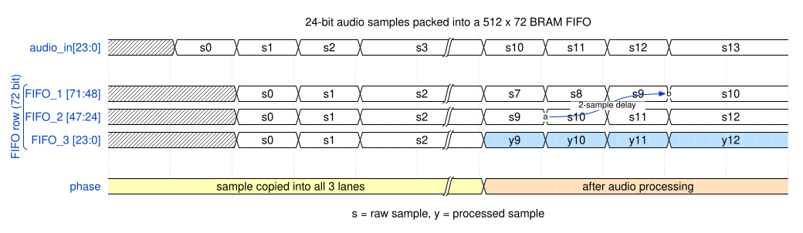

# Utilizing DSP to create audio effects using FPGA

Lasse Nørbjerg s253860

December 2026


## Introduction


## Methods

### Setup


**Figure [^setup]: 1: Audio goes into microphone. 2: Microphone sends audio to PC. 3: PC sends audio data as PCM through UART to FPGA. 4: FPGA processes audio data. 5: FPGA sends processed audio back through UART. 6: PC plays the processed audio back to the user.**

### Hardware

FPGA board is the Basys3 board[^1]. It is part of the Artix-7 35t family[^1][^9].

For completeness. A Shure SM57 is going into a Focusrite Scarlett solo USB audio interface, into the PC. Despite this, any audio input device can be used (with- and without an audio interface). 

### Software

AMD Vivado 2025.1 will be used for synthesizing [^11]. The hardware will be described using Chisel [^12].

### Audio Format

Audio will be sent through the PC using PCM format[^4]. PCM has a `sample rate`, and the width of those samples called `bit depth`.

The expected bit depth and sample rate will be hardwired in the fpga. Future iterations could support a handshake exchanging typical header information.

The samples are usually signed in two's complement[^7]. We will therefore be using SInt in the Chisel code.

### BRAM as a FIFO

Industry records at 24-bit, 44.1 or 48kHz [^2]. The G.711 codec can be considered the lower bound of intelligible audio. It has 8kHz sampling with 8 bits [^3].

The Basys3 has 50 blocks of BRAM (1800Kb total) [^9]. Each block can - among other non-FIFO things - be configured as a `512 x 72` (512 rows of 72 bits = 36Kb) FIFO [^9].

If we use 24 bits. We can have $72/24 = 3$ samples at every row. We can then have $512*50 = 25600$. If we have a sample rate of 44.1kHz, we have a buffer of $25600/44100 = 0.58s$. Typical ranges of reverb is between 0.8 and 4s[^8]. We might have to loop the fifo onto itself. For now we can live with this. If we wanted to utilize the multi line of samples, we could have a setup like


**Figure [^fifo_lines]: Samples can be copied to 3 lines for the fifo block. This can be used e.g. as a delay line, a real line, and a processed line - like shown in the figure.**

This will be abstracted away by letting Chisel and Vivado infer what is meant through Chisel's .


## Results

### Determining Length of Audio in Buffer

First we will create an equation with variables representing - bit depth, sample rate, and buffer size.

Let $B$ represent the bit depth, $R$ the sample rate (Hz), and $S$ the buffer size (bits). The length of audio in the buffer $L$ can be calculated as:
$$
L = \frac{S}{R \cdot B}
$$

> [!Note] 
> $$\frac{bits}{\frac{1}{s} \cdot bits} = s$$


| B  (bits) | R    (Hz) | S      (bits) | L (s)  |
| --------- | --------- | ------------- | ------ |
| 24        | 48_000    | 1_800_000     | 15.625 |
| 8         | 8_000     | 1_800_000     | 28.125 |


15 seconds is more than plenty for simple echoes. This shows that Buffer size is not a blocker.


## Discussion


## AI Acknowledgements

### fifo_lines
```
opus 5.5

make a wavedrom table, that shows an audio sample packets coming in (24 bits if it is relevant). It should be copied into 3 new signals. referencing parts of a fifo (because the fifo is 72 bits). Call it FIFO_1, FIFO_2, FIFO_3. then there should be a break, where you say audio processing happened. then you should indicate that FIFO_1 is delayed a couple of samples from FIFO_2. FIFO_3 has some processed audio.
```

### FIFO_DUAL_CLOCK_MACRO typing
```
haiku 5.5 (selected io without types)

can you infer the types and so on
```
created the depth based on the table


## References
[^1]: https://digilent.com/reference/basys3/refmanual

[^2]: https://majormixing.com/audio-sample-rate-and-bit-depth-complete-guide/

[^3]: https://en.wikipedia.org/wiki/G.711

[^4]: https://en.wikipedia.org/wiki/Pulse-code_modulation

[^5]: https://www.analog.com/en/resources/technical-articles/relationship-data-word-size-dynamic-range.html
<!-- should have more bits when processing. just a float thing tho -->

[^6]: https://en.wikipedia.org/wiki/Audio_bit_depth

[^7]: https://ccrma.stanford.edu/~jos/mdft/Pulse_Code_Modulation_PCM.html

<!-- []: https://wiki.sierrahelp.com/index.php/PCM#Integer_Or_Floating_Point -->

<!-- []: https://nandland.com/lesson-15-what-is-a-block-ram-bram/ -->

<!-- []: https://docs.amd.com/v/u/en-US/ug473_7Series_Memory_Resources -->

[^8]: https://www.soundbridge.io/reverb-and-delay-tips-for-cleaner-deeper-mixes

[^9]: https://pcbsync.com/artix-7-35t/

[^fifo_lines]: [fifo_lines](#fifo_lines)

[^setup]: [docs/setup.svg](docs/setup.svg)


[^11]: https://www.amd.com/en/products/software/adaptive-socs-and-fpgas/vivado/vivado-whats-new.html#tabs-de9b056824-item-12e22c06e7-tab

[^12]: https://www.chisel-lang.org/
