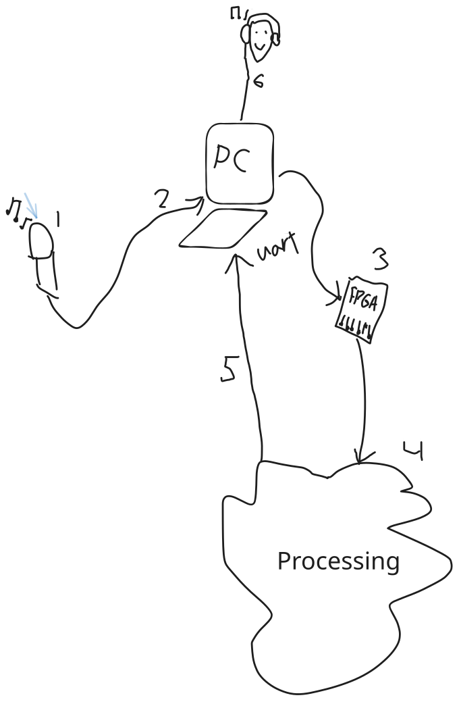

# Utilizing DSP to create audio effects using FPGA

Lasse Nørbjerg s253860

October 2026

## Introduction

## Methods

### Setup

### Hardware

FPGA board is the Basys3 board[^1].

Any microphone can be used. 

### Audio Format

Audio will be sent through the PC using PCM format[^4]. PCM has a `sample rate`, and the width of those samples called `bit depth`.

The expected bit depth and sample rate will be hardwired in the fpga. Future iterations could support a handshake exchanging typical header information.

The samples are usually signed in two's complement[^7]. We will therefore be using SInt in the Chisel code.

### BRAM as a FIFO

Industry records at 24-bit, 44.1 or 48kHz [^2]. The G.711 codec can be considered the lower bound of intelligible audio. It has 8kHz sampling with 8 bits [^3].

The Basys3 has 50 blocks of BRAM (1800Kb total) [^9]. Each block can - among other things - be configured as a `512 x 72` (512 rows of 72 bits) FIFO [^9].

If we use 24 bits. We can have $72/24 = 3$ samples at every row. This can be used to e.g. offset 

## Results

### Determining Length of Audio in Buffer

First we will create an equation with variables representing - bit depth, sample rate, and buffer size.

Let $B$ represent the bit depth, $R$ the sample rate (Hz), and $S$ the buffer size (bits). The length of audio in the buffer $L$ can be calculated as:
$$
L = \frac{S}{R \cdot B}
$$

> [!Note] 
> $$\frac{bits}{\frac{1}{s} \cdot bits} = s$$

| B  (bits) | R    (Hz) | S      (bits) | L (s)  |
| --------- | --------- | ------------- | ------ |
| 24        | 48_000    | 1_800_000     | 15.625 |
| 8         | 8_000     | 1_800_000     | 28.125 |

15 seconds is more than plenty for simple echoes. This shows that Buffer size is not a blocker.

## Discussion

## References
[^1]: https://digilent.com/reference/basys3/refmanual

[^2]: https://majormixing.com/audio-sample-rate-and-bit-depth-complete-guide/

[^3]: https://en.wikipedia.org/wiki/G.711

[^4]: https://en.wikipedia.org/wiki/Pulse-code_modulation

[^5]: https://www.analog.com/en/resources/technical-articles/relationship-data-word-size-dynamic-range.html

[^6]: https://en.wikipedia.org/wiki/Audio_bit_depth

[^7]: https://ccrma.stanford.edu/~jos/mdft/Pulse_Code_Modulation_PCM.html

[^8]: https://wiki.sierrahelp.com/index.php/PCM#Integer_Or_Floating_Point

[^14]: https://nandland.com/lesson-15-what-is-a-block-ram-bram/

[^15]: https://docs.amd.com/v/u/en-US/ug473_7Series_Memory_Resources

[^9]: https://pcbsync.com/artix-7-35t/
